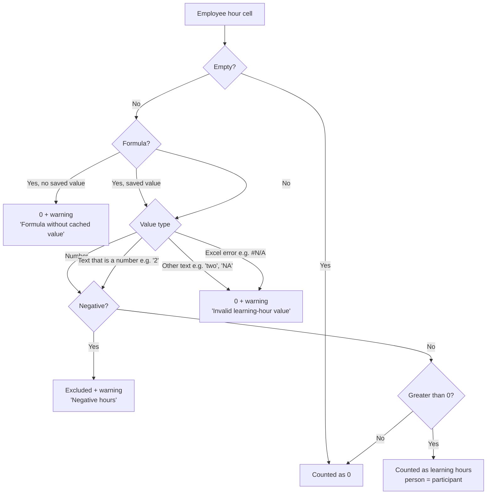
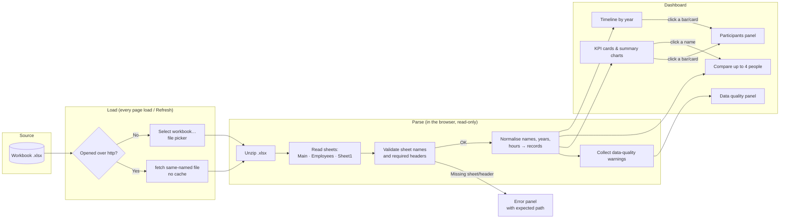
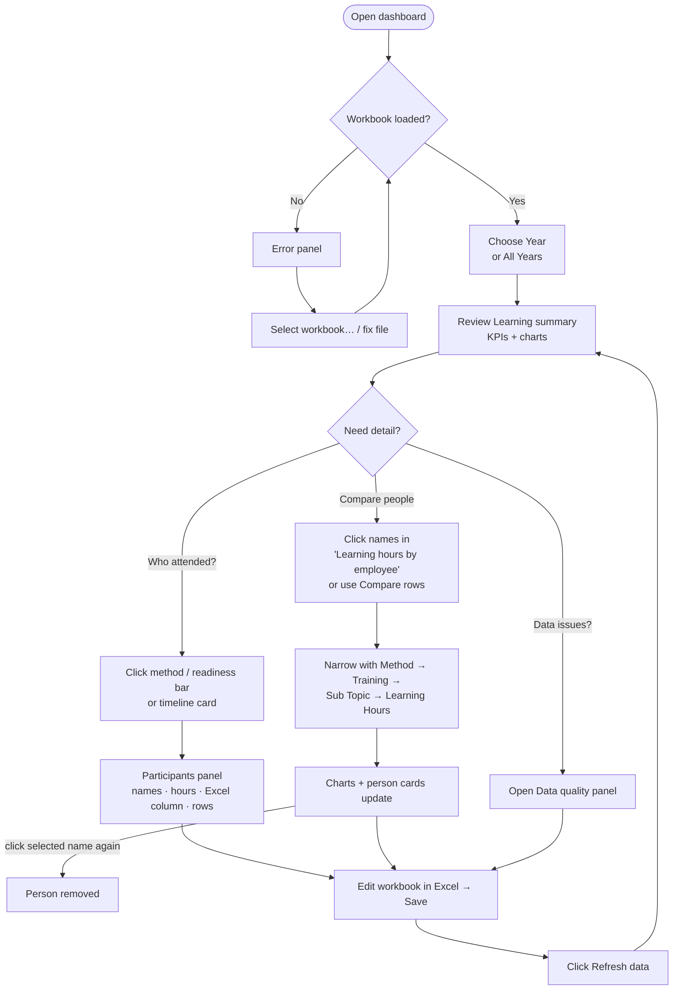

# TransAxle Learning & Development Dashboard

A single-file, offline web dashboard (`index_v.1.0.html`) that reads the team learning tracker Excel workbook and shows learning hours, target achievement, readiness programmes, person-to-person comparisons and a yearly training timeline.

- **Single file:** all HTML, CSS and JavaScript are inside `index_v.1.0.html`. No libraries, no internet, no database.
- **No hard-coded data:** every name, year, method, training and number shown comes from the workbook at load time.
- **Read-only:** the dashboard never modifies, locks or saves the workbook.

---

## 1. Purpose

| Goal | How the dashboard supports it |
|---|---|
| Track learning hours against the yearly target (default **40.00 h**) | KPI cards, target-achievement donut, per-employee bar chart with a dashed target line |
| Monitor readiness programmes (BTV Batch 1/2, PLATON Basic/Advanced) | Readiness KPI cards and chart with participation % and hours |
| Compare up to 4 people | Compare section with cascading filters, charts and person cards |
| See which trainings were conducted each year | Timeline grouped by year with Technical / Behavioral filters and search |
| Verify numbers against Excel | Participants panel lists names, hours, the employee's Excel column and the workbook row numbers |
| Find data-entry problems | Data quality panel lists missing names, invalid hours, blank years, etc. |

---

## 2. Files

| File | Purpose |
|---|---|
| `index_v.1.0.html` | The dashboard (open in a browser) |
| `Powertrain engineering Learning Tracker_V2_20261120_k18.1.xlsx` | The data source (the "backend" workbook) |
| `DASHBOARD_README.md` | This document |

---

## 3. Quick start

### Option A — automatic loading (recommended)

1. Put `index_v.1.0.html` in the **same folder** as the workbook.
2. Open a terminal in that folder and run:
   ```
   python -m http.server 8000
   ```
3. Open <http://127.0.0.1:8000/index_v.1.0.html>.
4. After editing and saving the workbook, click **Refresh data**. No restart is needed.

### Option B — open the file directly

1. Double-click `index_v.1.0.html`.
2. Browsers do not allow a page opened from disk to read other files, so the page shows a message. Click **Select workbook…** and choose the `.xlsx` file.
3. In Edge/Chrome, **Refresh data** re-reads the same file after you save it. In other browsers, select the file again after each save.

---

## 4. Configuration

All settings are in one block at the top of the `<script>` in `index_v.1.0.html`.

### 4.1 `BACKEND_WORKBOOK_PATH`

```js
const BACKEND_WORKBOOK_PATH = String.raw`C:\...\Powertrain engineering Learning Tracker_V2_20261120_k18.1.xlsx`;
```

- This is the **only** place the workbook path is defined.
- When served over http (Option A), the page loads the file **with the same name next to the HTML**. A browser cannot read an absolute `C:\` path, so only the file name part is used.
- A relative path (for example `data/tracker.xlsx`) is also accepted when served over http.
- The value is shown in the error panel so users know which file is expected.

### 4.2 `CONFIG` (layout and rules)

| Setting | Default | Meaning |
|---|---|---|
| `mainSheet` | `Efficiency measures _Summary` | Learning-data worksheet (exact name) |
| `trainingListSheet` | `Sheet1` | Maintained training list |
| `employeeSheet` | `Employees` | Team roster |
| `headerRow` | `3` | Header row in the main sheet |
| `firstDataRow` | `5` | First learning record row |
| `firstEmployeeColumn` | `I` | First employee-name column in the header row |
| `trainingListColumn` / `trainingListFirstRow` | `B` / `2` | Where the training list starts |
| `employeeRow` / `employeeFirstColumn` | `2` / `B` | Where the roster starts |
| `requiredHeaders` | Method, Training/Learning, Sub Topic, Year | Missing any of these stops loading |
| `targetHours` | `40` | Learning target in hours |
| `maxPeople` | `4` | Maximum people in Compare |
| `colors` | Blue, Purple, Green, Amber | Colours for P1–P4 |
| `belowTargetColor` | Red `#DC2626` | Totals > 0 and below target |
| `zeroHoursColor` | Grey `#94A3B8` | Totals of exactly 0 hours |
| `onTargetColor` | Teal `#0D9488` | Target achieved (summary charts) |
| `kpiCategories` | BTV Batch 1/2, PLATON Basic/Advanced | Readiness programme matching rules |
| `trainingTypes` | Behavioral / Technical | Method → type mapping for the timeline |
| `timelineCollapsedCount` | `8` | Cards shown per year before "Show more" |
| `chartTopCategories` | `7` | Categories shown before grouping into "Other" |

---

## 5. Workbook format (fixed)

The workbook must be an **`.xlsx`** file with these three worksheets. Worksheet names must match **exactly**, including spaces and capitals.

### 5.1 Main sheet — `Efficiency measures _Summary`

Matrix layout: one **row per learning record**, one **column per employee**.

```
        A        B        C                   D           E                 F      G         H                      I            J            ...
Row 3   Sl_No    Method   Training/Learning   Sub Topic   Trainer name...   Year   Remarks   TOTAL LEARNING...      Employee 1   Employee 2   ...
Row 4   (formula totals per employee — ignored by the dashboard)
Row 5   1        TecCom   E-drive Module 2                                  2026             (formula)              32                        ...
Row 6   ...
```

| Area | Rule |
|---|---|
| **Header row (row 3), columns A–H** | Headers are found by name (case and extra spaces ignored), not by fixed position. **Required:** `Method`, `Training/Learning`, `Sub Topic`, `Year`. **Optional:** `Sl_No`, `Trainer name (if internal)`, `Remarks`, `TOTAL LEARNING (In Hours)` |
| **Employee names (row 3, from column I)** | One name per column, read left to right **until the first blank header cell**. Anything after a gap (for example helper lists far to the right) is ignored |
| **Row 4** | Ignored. Excel formula totals are not used |
| **Column H (TOTAL LEARNING)** | Ignored for calculations, so hours are never double-counted |
| **Records (row 5 onward)** | Each row is one training record. A row is ignored as empty when Method, Training/Learning and Sub Topic are blank **and** no employee has hours in it |
| **Hour cells** | See 5.4 |
| **Year** | Number (`2026`) or text (`"2026"`). Blank → shown as **Year not specified** |

### 5.2 Roster sheet — `Employees`

| Area | Rule |
|---|---|
| Names | **Row 2, from column B**, one per column, left to right |
| Blanks | Skipped |
| Duplicates | Counted once; reported in Data quality |
| Role | Defines the **team** used for KPIs and summary charts |

### 5.3 Training list — `Sheet1`

| Area | Rule |
|---|---|
| Trainings | **Column B, from row 2**, one per row |
| Role | Used only to warn when a record's Training/Learning value is not in this list. If the sheet is missing, the check is skipped with a warning |

### 5.4 Learning-hour cell rules



### 5.5 Name matching

- Leading/trailing spaces are removed and repeated spaces collapsed.
- Matching between sheets is **not case-sensitive** (`AJITH KUMAR` = `Ajith Kumar`).
- The name shown is taken from the `Employees` sheet when available.

---

## 6. Data restrictions and assumptions

| # | Restriction / assumption | Effect if not followed |
|---|---|---|
| 1 | File must be **`.xlsx`** (Office Open XML). `.xls`, `.csv`, `.xlsb` are not supported; `.xlsm` is untested | Error: "not a valid .xlsx workbook" |
| 2 | Workbook must **not be password-protected / encrypted** | Error: workbook cannot be read |
| 3 | The three worksheet names must match exactly | Error panel lists the missing sheet and available sheets |
| 4 | Required headers must be in **row 3, before column I** | Error panel lists the missing header(s) |
| 5 | Employee header columns must be **contiguous** from column I | Names after the first blank header cell are ignored |
| 6 | Hours must be **numbers** (decimals allowed) | Text → counted as 0 and reported |
| 7 | Hours must be **≥ 0** | Negative values excluded and reported |
| 8 | The workbook must have been **saved by Excel** (so formula results are cached) | Formula cells without saved results count as 0 and are reported |
| 9 | Year should be a plain **number or text**, not an Excel date | Dates appear as serial numbers |
| 10 | Merged cells: only the top-left cell holds the value | Other merged cells are treated as blank |
| 11 | Hidden rows/columns are **still read** | Hide ≠ exclude; delete or clear data instead |
| 12 | KPI and summary totals include **only people in the `Employees` sheet** | Others are shown in Compare ("Main sheet only"), timeline and Data quality |
| 13 | Totals are calculated from individual cells | May differ from Excel's cached `TOTAL` cells if those are hard-coded or stale |
| 14 | Saving the workbook while the dashboard reads it | Read may fail; click **Refresh data** again |

---

## 7. Data flow



## 8. User flow



---

## 9. Dashboard sections

### 9.1 Header
Workbook name, last modified time, last refresh time, selected year, learning target, **Year** filter, **Refresh data**, **Select workbook…**

### 9.2 Learning summary (team = `Employees` sheet)

| KPI | Calculation |
|---|---|
| Total Employees | Unique names in the `Employees` sheet |
| Total Learning Hours | Sum of all team members' hour cells for the selected year |
| Avg Hours / Employee | Total Learning Hours ÷ Total Employees (0.00 if no employees) |
| At or above 40 h | Team members with total ≥ 40.00 |
| Below 40 h | Team members with total < 40.00 (includes 0 h) |
| BTV Training – Batch 1 / 2 | Method or Training contains "BTV" **and** Training/Learning = "Batch 1" / "Batch 2" |
| PLATON Readiness – Basic | Method or Training contains "PLATON" **and** Sub Topic = "Basic" or "Basics" |
| PLATON Readiness – Advanced | Method or Training contains "PLATON" **and** Sub Topic = "Advanced" |

Readiness cards show participants (hours > 0), hours, and % of the team.

**Charts:** Target achievement donut (achieved / below / no hours), Learning hours by method, Readiness programmes, Learning hours by year (click to filter), Learning hours by employee (click to add/remove from Compare).

### 9.3 Compare team learning
- Starts with one row; **Name is required**. `+` adds rows up to 4; `−` appears when there are 2+ rows.
- Filters cascade: **Method → Training/Learning → Sub Topic → Learning Hours** and only list values the selected person actually has.
- A person cannot be selected twice.
- Charts: Total learning hours (with target line), Breakdown by Method, Breakdown by Training/Learning, and person cards (filtered total, overall total, items, % of target, unique methods, training categories).

### 9.4 Training conducted by year
Records grouped by **Year → Method + Training/Learning + Sub Topic**, with participants, hours and average. Filter by **All / Technical / Behavioral** and search by training or sub topic. Click a card to open the participants panel.

Type mapping (configurable in `CONFIG.trainingTypes`):

| Type | Rule |
|---|---|
| Behavioral | Method = `HR`, or Training/Learning contains "Behavioral"/"Behavioural" |
| Technical | Method is one of TecCom, Product Hands On learning, Focus competency group, PLATON, BTV training, External Training, Internal training, Upskilling |
| Other/Unclassified | Anything else (e.g. Daimler Mandatory Training, Others) |

### 9.5 Participants panel (verification)
Opens on the right side. Shows the title, participants, total and average hours, **workbook row numbers**, and each participant's **hours and Excel column** with a Compare/Remove button. **Copy list** copies names and hours for pasting into Excel.

### 9.6 Data quality
Lists, without stopping the dashboard:
- Roster names missing from the main sheet (shown with 0.00 h)
- Main-sheet names missing from the roster
- Duplicate names
- Invalid, negative, or uncached formula hour cells (with cell reference)
- Records missing Year / Method / Training/Learning (with row number)
- Training values not in `Sheet1`
- Headers that could not be matched
- Count of empty rows ignored

---

## 10. Colour and status rules

| Total hours | Colour | Status text |
|---|---|---|
| 0.00 | Grey | No learning hours (below 40-hour target) |
| > 0 and < 40.00 | Red | Below 40-hour target |
| ≥ 40.00 | Person colour (Compare) / Teal (summary) | Target achieved |

- Status is evaluated on the **unrounded** value (39.999 shows as 40.00 but is still below target).
- All hours are displayed with **two decimals**.
- Status is always shown as text as well as colour.

---

## 11. Browser support

| Browser | Status |
|---|---|
| Microsoft Edge / Google Chrome (current) | Fully supported, including re-reading a selected file on Refresh |
| Firefox (113+) | Supported; re-select the file after each save when opened from disk |
| Safari (16.4+) | Supported |
| Internet Explorer | Not supported |

Animations are switched off automatically when the operating system's "reduce motion" setting is on.

---

## 12. Troubleshooting

| Message / symptom | Cause | Fix |
|---|---|---|
| "This page was opened directly from disk…" | Browser security on `file://` | Use **Select workbook…** or Option A (http server) |
| "Workbook not found next to this page" | File name differs or file is in another folder | Put the workbook beside the HTML or update `BACKEND_WORKBOOK_PATH` |
| "Worksheet … was not found" | Sheet renamed | Restore the exact sheet name or update `CONFIG` |
| "Missing expected header(s)…" | Header text changed or moved | Restore header text in row 3 (columns A–H) |
| "not a valid .xlsx workbook" / "corrupt" | Wrong format, still saving, or damaged | Save as `.xlsx`, wait for Excel to finish saving, then **Refresh data** |
| "The browser no longer allows reading the selected workbook" | File permission expired | Click **Select workbook…** again |
| A person is missing from KPIs | Not in the `Employees` sheet | Add the name to row 2 of `Employees` |
| Total differs from Excel's TOTAL column | Excel total cell is hard-coded/stale | Dashboard uses individual cells; fix the Excel formula |
| Numbers didn't change after editing | Workbook not saved, or page not refreshed | Save in Excel, then **Refresh data** |

---

## 13. Verification checklist

- [ ] Dashboard loads and shows the workbook name and modified time.
- [ ] Total Employees equals the number of names in `Employees` row 2.
- [ ] A participants panel's names and hours match the Excel row/columns shown.
- [ ] Year filter changes KPIs, charts, Compare and timeline.
- [ ] Clicking a name in "Learning hours by employee" adds it to Compare; clicking again removes it.
- [ ] Totals of 0 h are grey, < 40 h red, ≥ 40 h coloured.
- [ ] Edit an hour in Excel → Save → **Refresh data** → value updates.
- [ ] Rename the workbook → a readable error appears.
- [ ] The workbook's modified time is unchanged after using the dashboard.
